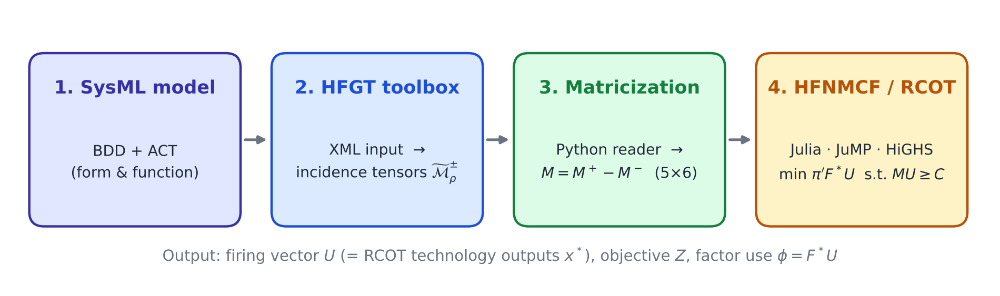
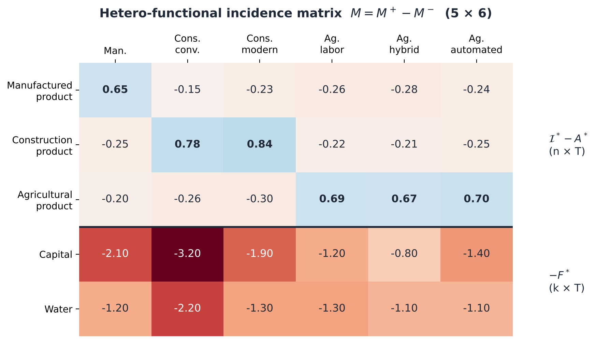
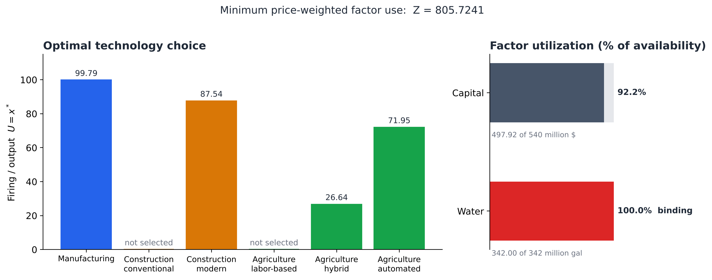
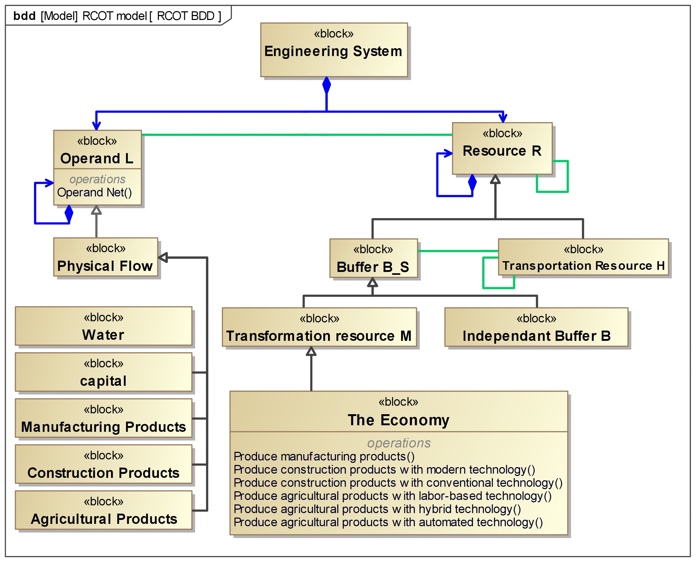
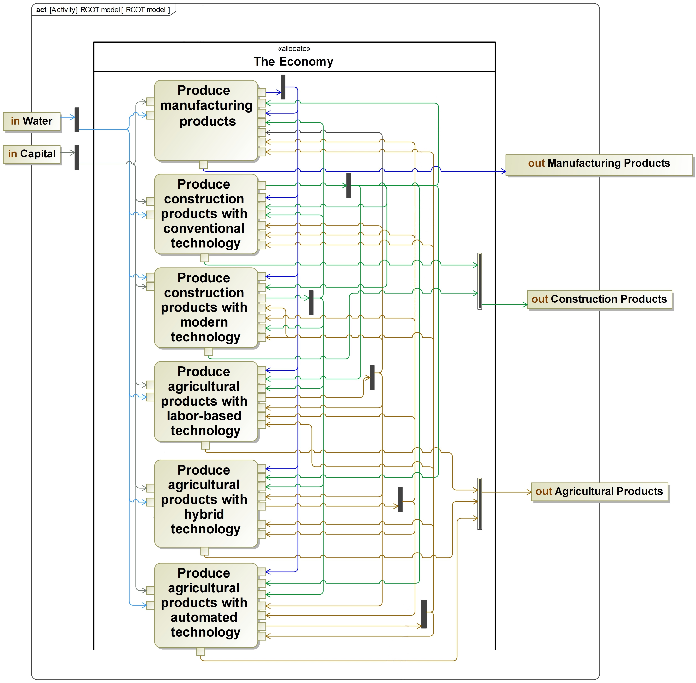

<div align="center">

# Integrating Economic Input–Output Models into MBSE-HFGT

**Code and data for the paper**<br>
*Toward a Unified Modeling Approach to Coupled Human-Natural Systems:<br>Integrating Economic Input-Output Models into MBSE-HFGT*


</div>

---

This repository reproduces the case study in the paper: a **Rectangular Choice of Technology (RCOT)** economic input–output model, represented in **SysML** and translated into **Hetero-Functional Graph Theory (HFGT)**. The RCOT linear program is solved as a special case of the Hetero-functional Network Minimum Cost Flow (HFNMCF) problem, and its solution reproduces the traditional RCOT solution within the reported numerical precision.

<p align="center">
  
</p>

## The core idea in one equation

The two RCOT constraints, the sectoral balance and the factor availability, are stacked into a single HFGT constraint:

$$
\underbrace{\begin{bmatrix} \mathcal{I}^* - A^* \\ -F^* \end{bmatrix}}_{M\ (n+k)\times T}
\underbrace{x^*}_{U\ T\times 1}
\ \ge\
\underbrace{\begin{bmatrix} y \\ -f \end{bmatrix}}_{C\ (n+k)\times 1},
\qquad
\min_{U \ge 0}\ Z = \pi' F^* U
$$

| RCOT | HFGT |
|---|---|
| Technology-output vector $x^*$ | Firing vector $U$ (one entry per capability) |
| $\mathcal{I}^* - A^*$ and $-F^*$ | Hetero-functional incidence matrix $M = M^+ - M^-$ |
| Final demand $y$, factor availability $f$ | Right-hand side $C = [y;\,-f]$ |

<p align="center">
  
</p>

## Repository structure

```
.
├── EIO-Defaultxml-Base-2026-02-02-Nogit.xml   # HFGT toolbox input: operands, the economy, 6 transformation processes
├── MLPPos_MLPNeg_reader.py                    # reads M+ and M- from the toolbox output and forms M = M+ - M-
├── EIO_HFNMCF.jl                              # solves the HFNMCF / RCOT problem with JuMP + HiGHS
├── scripts/make_figures.py                    # regenerates the figures in this README
└── figures/                                   # figures used in this README
```

## Requirements

| Tool | Used for |
|---|---|
| HFGT toolbox (latest version; see the paper for the reference) | generating the hetero-functional incidence tensors |
| Python 3 with `numpy`, `h5py` (and `matplotlib` for figures) | extracting $M$ |
| Julia with `JuMP` and `HiGHS` | solving the optimization problem |

```julia
using Pkg; Pkg.add(["JuMP", "HiGHS"])
```

## Reproducing the results

**1. Generate the incidence tensors.** Run `EIO-Defaultxml-Base-2026-02-02-Nogit.xml` with the HFGT toolbox. This produces the positive and negative hetero-functional incidence tensors of the economic system.

**2. Extract the incidence matrix.** Set `file_path` in `MLPPos_MLPNeg_reader.py` to the toolbox output file, then run:

```bash
python MLPPos_MLPNeg_reader.py
```

The script prints $M^+$, $M^-$, and $M = M^+ - M^-$.

> **Note on ordering.** The toolbox may list operands in a different order from the paper. The paper and `EIO_HFNMCF.jl` use the rows *Manufactured, Construction, Agricultural, Capital, Water*.

**3. Solve the optimization problem.**

```bash
julia EIO_HFNMCF.jl
```

## Results

<p align="center">
  
</p>

| Capability (technology) | $U = x^*$ |
|---|---:|
| Manufacturing | 99.7883 |
| Construction, conventional | 0 |
| Construction, modern | 87.5364 |
| Agriculture, labor-based | 0 |
| Agriculture, hybrid | 26.6439 |
| Agriculture, automated | 71.9531 |
| **Objective $Z$** | **805.7241** |

Water is the binding factor (342 of 342 million gallons); capital use is 497.92 of 540 million dollars. Compared component by component with an independent solution of the traditional RCOT linear program, the maximum absolute difference is $3.4\times10^{-5}$ and the maximum relative difference is $1.9\times10^{-7}$, both due to four-decimal rounding.

## Model diagrams

The SysML diagrams of the economic system from the paper:

| Block Definition Diagram (form) | Activity Diagram (function) |
|:---:|:---:|
|  |  |

## Scope

This is a static, single-period, synthetic case study with one economic system. It demonstrates the translation of an RCOT model into MBSE-HFGT and the equivalence of the two optimization problems. Coupling with environmental systems, temporal dynamics, and spatially explicit applications are directions for future work.

## Citation

If you use this code, please cite the paper:

```bibtex
@article{10.1016/j.jclepro.2026.149798,
  title   = {Toward a Unified Modeling Approach to Coupled Human-Natural Systems: Integrating Economic Input-Output Models into MBSE-HFGT},
  author  = {M. M. Naderi, Megan Harris, John Little and Amro Farid},
  journal = {Journal of Cleaner Production},
  year    = {2026},
  note    = {Under review}
}
```

## Acknowledgments

This research was supported by the NSF Growing Convergence Research Award *Convergent Anthropocene Systems (ANTHEMS): A System-of-Systems Paradigm*.
